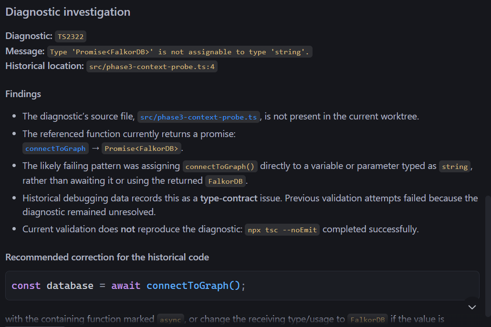
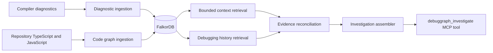
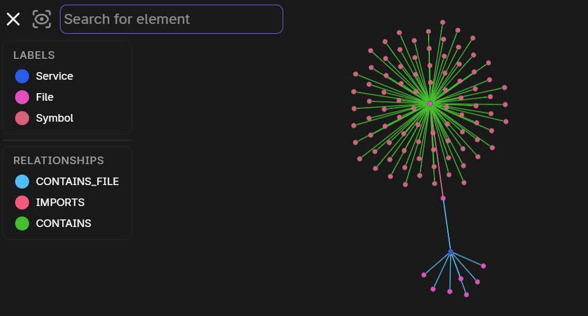

# DebugGraph

**Evidence-based debugging context for AI coding agents.**

[](https://github.com/sambhavgsharma/DebugGraph/stargazers)
[](https://github.com/sambhavgsharma/DebugGraph/network/members)
[](https://github.com/sambhavgsharma/DebugGraph/issues)
[](https://github.com/sambhavgsharma/DebugGraph)

DebugGraph is a TypeScript debugging context layer for AI coding agents. It
stores compiler diagnostics, code structure, debugging sessions, hypotheses,
attempts, patches, outcomes, and evidence in FalkorDB so investigations can
follow connected facts instead of repeatedly starting from an isolated error
message.



*The real read-only MCP investigation interface, including historical evidence,
reconciliation findings, and a recommendation.*

- [Repository](https://github.com/sambhavgsharma/DebugGraph)
- [Architecture](#how-it-works)
- [Setup](#quick-start)
- [Issue tracker](https://github.com/sambhavgsharma/DebugGraph/issues)

## The problem

An error message is only one observation. A useful debugging decision often
also depends on the affected file and symbols, nearby imports and calls, the
hypotheses an agent has already considered, the commands it has tried, and the
evidence those attempts produced.

Without persistent context, an agent can repeat a failed experiment, treat an
old diagnostic as if it were current, or apply project-level evidence to the
wrong problem. DebugGraph preserves these relationships and makes their
provenance explicit, while keeping recommendations bounded and cautious.

## What DebugGraph does

The current implementation provides:

- **Compiler diagnostic ingestion** with stable diagnostic identities, source
  locations, scan sessions, and nearest-symbol associations where available.
- **Graph-based code context** from TypeScript and JavaScript files, including
  files, symbols, local imports, and resolved calls.
- **Persistent debugging history** for sessions, hypotheses, attempts, patches,
  outcomes, and evidence.
- **Evidence-aware investigation** that combines a diagnostic's bounded code
  context with related debugging history.
- **Conservative reconciliation** that distinguishes current-scan presence,
  diagnostic-associated evidence, uncertain project-level evidence, and
  conflicting provenance.
- **Read-only MCP exposure** through the `debuggraph_investigate` tool.

Autonomous code repair is **not implemented**. DebugGraph does not select or
apply patches on behalf of an agent.

## How it works



Code ingestion parses supported source files and writes idempotent graph
records. Diagnostic ingestion runs the configured TypeScript compiler program
and records a scan session. The investigation assembler then traverses bounded
code context and bounded debugging history before producing facts,
reconciliation results, and conservative recommendations.

Schema initialization and validation are implemented in
[`src/graph/schema.ts`](./src/graph/schema.ts), but they are not wired to an
npm script and do not run automatically.

## Graph data model

The schema defines these node labels:

| Area | Labels |
| --- | --- |
| Code | `Service`, `File`, `Symbol`, `Type`, `APIEndpoint` |
| Diagnostics | `Diagnostic` |
| Debugging history | `Session`, `Hypothesis`, `DebugAttempt`, `Patch`, `Evidence` |

Relationships used by the current implementation include:

- `Service -[:CONTAINS_FILE]-> File`
- `File -[:CONTAINS]-> Symbol`
- `File -[:IMPORTS]-> File`
- `Symbol -[:CALLS]-> Symbol`
- `Diagnostic -[:LOCATED_IN]-> File` and diagnostic-to-symbol associations
- `Session -[:TARGETS]-> Diagnostic`
- `Session -[:HAS_HYPOTHESIS]-> Hypothesis`
- `Session -[:HAS_ATTEMPT]-> DebugAttempt`
- `Hypothesis -[:TESTED_BY]-> DebugAttempt`
- `DebugAttempt -[:APPLIES]-> Patch`
- `DebugAttempt -[:HAS_EVIDENCE]-> Evidence`
- evidence-to-hypothesis relations such as `SUPPORTS`, `CONTRADICTS`, and
  `VALIDATES`

The exact code-context response exposes bounded `CONTAINS`, `IMPORTS`, `CALLS`,
and `LOCATED_IN` relationships. Traversing these edges lets an investigation
move from a diagnostic to its file, symbols, imported files, callers, and
callees without loading an unbounded repository snapshot.



*The graph view shows `Service`, `File`, and `Symbol` nodes and their code
relationships; it does not represent every debugging-history relationship.*

## Evidence and investigation

DebugGraph labels evidence according to the strength of its connection to the
requested diagnostic:

- **Diagnostic-associated** evidence comes from a session with an explicit,
  unambiguous `TARGETS` relationship to that diagnostic.
- **Project-level uncertain** evidence comes from project history without a
  diagnostic-specific provenance link.
- **Conflicting-provenance uncertain** evidence comes from associated history
  whose targeting information is incomplete or conflicting.

Reconciliation also reports whether the diagnostic is `present` in the latest
completed compiler scan, `historical-only`, or `unknown` when no completed scan
is available. A historical failure does not prove that the diagnostic still
exists. Conversely, a successful standalone compiler run does not
automatically resolve a particular historical diagnostic unless the current
scan and provenance support that conclusion.

Recommendations are deliberately conservative. For example, a failed
historical attempt produces a recommendation to avoid repeating it without
new evidence; an unresolved hypothesis produces a recommendation to investigate
it against relevant code context; and missing or unevaluated evidence produces
a recommendation to run a focused diagnostic or test. Each recommendation
retains supporting record IDs, context IDs, and an uncertainty statement.

## Quick start

### Prerequisites

- Git
- Node.js and npm
- Docker Desktop with Docker Compose
- A local FalkorDB instance, or the repository's Compose service

The project currently pins TypeScript `5.9.3`, uses `tsx` for TypeScript
entry points, and targets a local FalkorDB service on Redis port `6379`.

### Windows PowerShell

Clone the repository and install dependencies:

```powershell
git clone https://github.com/sambhavgsharma/DebugGraph.git
Set-Location .\DebugGraph
npm ci
```

`npm install` is also supported when you intentionally want npm to resolve
dependencies from the manifest. Do not run both install commands for the same
setup.

Create local configuration from the checked-in example:

```powershell
if (-not (Test-Path .\.env)) {
  Copy-Item .\.env.example .\.env
}
```

The application reads these values from the process environment:

| Variable | Example/default | Purpose |
| --- | --- | --- |
| `FALKORDB_HOST` | `127.0.0.1` | FalkorDB host |
| `FALKORDB_PORT` | `6379` | FalkorDB port |
| `FALKORDB_GRAPH` | `DebugGraphDev` in `.env.example`; otherwise `DebugGraph` | Graph name |
| `FALKORDB_VOLUME` | `debuggraph-data` | External Docker volume name used by Compose |

The Node entry points do not load `.env` files themselves. Set variables in
PowerShell when running Node commands, or use a tool that loads the file
explicitly:

```powershell
$env:FALKORDB_HOST = "127.0.0.1"
$env:FALKORDB_PORT = "6379"
$env:FALKORDB_GRAPH = "DebugGraphDev"
```

Create the external volume once and start FalkorDB:

```powershell
npm run db:volume
npm run db:up
npm run db:status
```

Compose mounts that named volume at `/var/lib/falkordb/data` and binds the
database to localhost. Stopping the service does not remove the volume, so
data persists across normal restarts:

```powershell
npm run db:stop
npm run db:up
```

The repository does not provide an npm command that automatically initializes
the graph schema. If you need schema indexes and constraints, call the
exported `initializeSchema` function from
[`src/graph/schema.ts`](./src/graph/schema.ts) in your own one-off script
before ingestion. Schema initialization is idempotent.

### Cross-platform notes

The npm scripts and Docker Compose service are not Windows-specific. On
macOS/Linux, use the equivalent shell commands and environment-variable
syntax for your shell. The PowerShell sequence above is the repository's
verified setup path.

## MCP integration

The stdio MCP server starts with:

```powershell
npm run mcp
```

It registers one read-only tool: `debuggraph_investigate`.

Required input:

```json
{
  "diagnosticId": "diagnostic-id"
}
```

Optional input fields are bounded positive integers:

```json
{
  "diagnosticId": "diagnostic-id",
  "maxSessions": 20,
  "maxAttemptsPerSession": 100,
  "context": {
    "maxDiagnostics": 10,
    "maxFileSymbols": 50,
    "maxImportedFiles": 20,
    "maxImportedFileSymbols": 20,
    "maxCallers": 25,
    "maxCallees": 25
  }
}
```

The limits are validated by the server and cannot exceed the implementation's
configured maxima. The tool returns JSON containing the diagnostic, bounded
code context, historical sessions, facts, hypotheses, outcomes, evidence,
reconciliation, recommendations, and metadata. It performs no graph writes.

A generic stdio client configuration can launch the repository server as
follows; adapt the JSON wrapper to the MCP client you are testing:

```json
{
  "mcpServers": {
    "debuggraph": {
      "command": "npx",
      "args": ["tsx", "src/mcp-server.ts"],
      "cwd": "C:\\path\\to\\DebugGraph",
      "env": {
        "FALKORDB_HOST": "127.0.0.1",
        "FALKORDB_PORT": "6379",
        "FALKORDB_GRAPH": "DebugGraphDev"
      }
    }
  }
}
```

This repository documents the stdio server and does not claim compatibility
with a particular IDE or MCP client.

## CLI and development commands

Run commands from the repository root:

| Command | Purpose |
| --- | --- |
| `npm run ingest -- <path>` | Parse a repository and ingest files, symbols, local imports, and calls. The path defaults to the current directory. |
| `npm run diagnostics -- <path>` | Run compiler diagnostic ingestion and print the latest diagnostic records. |
| `npm run context -- <path> [diagnostic-id]` | Retrieve bounded context for the latest diagnostics or one diagnostic. |
| `npm run history -- <subcommand> <JSON>` | Record or retrieve debugging sessions, hypotheses, attempts, outcomes, patches, and evidence. |
| `npm run investigate -- <diagnostic-id>` | Assemble and print evidence-aware investigation context. |
| `npm run mcp` | Start the read-only stdio MCP server. |
| `npx tsc --noEmit` | Type-check the TypeScript source without emitting files. |
| `npm test` | Run the Node test suite through `tsx`. |
| `npm run db:volume` | Create the external Docker volume used by Compose. |
| `npm run db:up` | Start FalkorDB with Docker Compose. |
| `npm run db:status` | Show the Compose service status. |
| `npm run db:logs` | Show the last 100 FalkorDB log lines. |
| `npm run db:stop` | Stop the FalkorDB service without removing its volume. |
| `npm run db:down` | Remove the Compose service and network. |

The history CLI accepts `session`, `hypothesis`, `attempt`, `outcome`, `patch`,
`evidence`, and `show` subcommands. Its payloads are JSON objects validated by
the command implementation.

## Limitations and roadmap

### Current limitations

- No browser UI or HTTP application server.
- No automatic code-repair selection or patch application.
- No VS Code debugging interface.
- No API endpoint tracing or cross-service type-contract tracing.
- Schema initialization is not exposed as an npm script.
- Repeated-failure detection is limited to the current evidence-based
  recommendations.

### Future work

Potential follow-up work includes a user-facing investigation interface,
broader code and API relationships, richer repeated-failure detection, and an
agent workflow that can propose or apply repairs with explicit safeguards.
These are planned directions, not current capabilities.

## Contributing

Contributions are welcome. Before opening a pull request:

```powershell
npm ci
npx tsc --noEmit
npm test
git diff --check
```

Keep changes focused, add or update tests for behavior changes, and document
any changes to graph labels, relationships, limits, or MCP input/output
contracts. Please open an issue first for substantial design changes.

## License

License information has not yet been specified in this repository.

## Acknowledgments and hackathon

DebugGraph is built with [FalkorDB](https://www.falkordb.com/) and is being
submitted to **Graph Hacks: Context for AI Agents**, powered by FalkorDB. The
project's relevant track is **Agents That Act on Connected Data**. These
references describe the technology and submission context; they do not imply
endorsement, sponsorship, or a prize result.

## AI assistance disclosure

This project was developed with AI-assisted coding and documentation. All
generated changes remain subject to maintainer review, local verification, and
the repository's tests.
